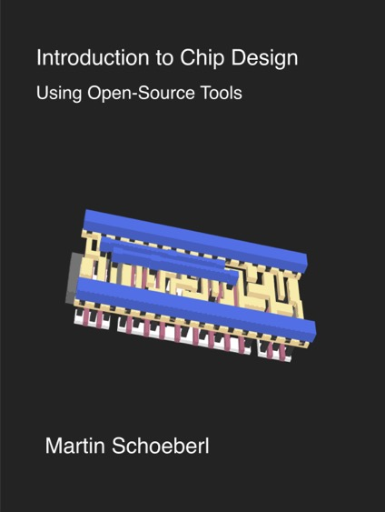

# Introduction to Chip Design
## Using Open-Source Tools

This eBook is an introduction to chip design for a Bachelor level class.
The practical labs focus on using open-source tools only.
This enables the students to explore and tinker in chip design on their own laptops.

[Download the latest PDF](https://github.com/os-chip-design/chip-design-book/releases/download/latest/chip-design-book.pdf).

[](https://www.imm.dtu.dk/~masca/chip-design-book.html)

GitHub Actions builds the PDF on each push and updates the single `latest`
release. Build locally with `make`.

Cite this book as:
```
@Book{chip:design:book,
  author       = {Martin Schoeberl},
  title        = {Introduction to Chip Design Using Open-Source Tools},
  year         = {2026},
  howpublished = {\url{https://www.imm.dtu.dk/~masca/chip-design-book.html}},
}
```
